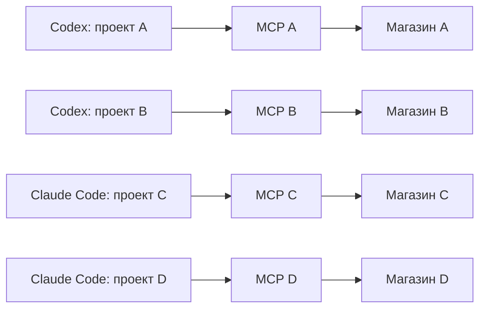

# Подключение магазина Яндекс KIT на уровне проекта

Дата: 2026-10-31. Статус: архитектура согласована; runtime и проектный setup
реализованы в исходниках. Полная offline-проверка пройдена; свежий итоговый
whole-branch review ещё впереди. Пакеты не опубликованы, реальные клиентские
проекты не подключались.

## Задача и принятые решения

Владелец одновременно обслуживает четыре магазина: два проекта в Codex и два
в Claude Code. Добавление магазина должно создавать самостоятельное подключение,
а не заменять токен магазина в остальных проектах.

Пользователь выбрал привязку **на уровне проекта**. Все чаты проекта работают
с одним магазином. Работа с несколькими магазинами из одного чата и выбор магазина
отдельно для каждого чата не нужны. Один и тот же проект можно открыть в обоих
агентах: магазин проекта при этом остаётся тем же.

Остальные решения ниже приняты при согласовании инженерного предложения;
они не являются ранее высказанными пользователем требованиями.

## Варианты

| Вариант | Что даёт | Цена и ограничения | Решение |
| --- | --- | --- | --- |
| Привязка магазина к проекту, отдельные MCP-процессы | Параллельная работа проектов; привычные инструменты без выбора магазина в каждом вызове | Нужны проектные адаптеры настройки и миграция глобального подключения | Выбран пользователем |
| Привязка отдельно к каждому чату | Разные магазины внутри одного проекта | Нужна поддержка настройки подключения на уровне сессии каждого клиента | Пользователь предпочёл уровень проекта |
| Один MCP с несколькими магазинами и параметром магазина в вызовах | Сводная работа и сравнение магазинов | Меняет интерфейсы инструментов и ответственность за выбор магазина | Не соответствует нужному сценарию |

Внутри выбранного варианта предлагается общая для агентов привязка проекта
и небольшое локальное хранилище секретов. Отдельный каталог магазинов с командами
переключения, фоновый сервис и облачный кабинет для первой версии не нужны.

## Исходное состояние до реализации

- `packages/mcp/src/config.ts` получает `YANDEX_KIT_TOKEN` из окружения.
- `packages/mcp/src/index.ts` создаёт один `KitClient` на процесс и передаёт его
  всем инструментам. Клиент сохраняет токен при создании.
- `skills/a1-yandex-kit-setup/` явно настраивает подключение на уровне пользователя:
  Codex — общий `config.toml`, Claude Code — корневой `mcpServers` в `~/.claude.json`.
- `--project-dir` сейчас участвует в обнаружении конфликтов; он не включает
  проектную область настройки. При конфликте мастер может выбрать второе
  глобальное имя `a1-yandex-kit-global`.
- Мастер уже имеет защищённую страницу ввода токена, проверку через `get_store`,
  резервное копирование, откат и адаптеры конфигурации разных клиентов.
- В пакетах есть переносимый `mcp.json` и совместимый `.mcp.json`. Подключение из
  плагина может сосуществовать с настроенным вручную сервером.

Основная работа относится к настройке и загрузке подключения. Интерфейсы
существующих инструментов каталога, заказов и акций сохраняются.

## Модель и хранение

**Проект** — явно выбранный корневой каталог магазина. Мастер получает этот
каталог от клиента или через `--project-dir`; не использует каталог установленного
скилла и не выбирает случайный родительский проект по текущему каталогу процесса.

**Привязка проекта** — файл `<project>/.yandex-kit/project.json` версии 1.
Он содержит `connection_id` — непрозрачный идентификатор подключения, без токена.
Это единственный источник выбора магазина для обоих агентов. Если файл уже есть,
подключение второго агента использует его, а не создаёт независимую привязку.

**Подключение** — приватная запись вне репозитория: токен, ожидаемый `store_id`,
версия формата и сохранённые название/адрес магазина для отображения. Имя файла
строится из сгенерированного UUID; произвольные пути в `connection_id` запрещены.
Предлагаемый каталог — `~/.a1-yandex-kit/connections/`. Реализация должна иметь
один общий способ разрешения этого пути для мастера и MCP, включая тестовую
подмену корня. На POSIX каталог имеет права `0700`, файлы и резервные копии `0600`;
на Windows используются ограничения доступа текущего пользователя.

Это файловое хранение секрета с ограничением доступа, не шифрованный сейф.
Интерфейс чтения/записи подключения отделяется от файловой реализации, чтобы
позднее добавить системное хранилище без изменения привязок проектов.

**MCP-процесс** получает явный абсолютный путь к привязке проекта, например через
новый аргумент `--project-config <path>`. Аргумент является предложением нового
интерфейса, а не существующей командой. Процесс однократно читает привязку и секрет,
создаёт один `KitClient` и обслуживает только этот магазин до завершения.

У одного проекта может быть несколько MCP-процессов — например, по одному на
чат или агент. Требование относится к их привязке, а не к точному числу процессов.
Общего изменяемого `current_store` нет.

## Контракт запуска и ошибки

1. Переданный `--project-config` однозначно включает проектный режим. Отсутствующий,
   повреждённый или неподдерживаемый файл, отсутствующий секрет и неизвестная
   версия формата завершают запуск с понятной диагностикой.
2. В проектном режиме `YANDEX_KIT_TOKEN` не участвует в выборе подключения, даже
   если остался в унаследованном окружении. Ошибка привязки никогда не приводит
   к использованию глобального токена.
3. Адрес KIT API в первой версии проектного режима фиксируется на штатном адресе
   клиента. Унаследованный `YANDEX_KIT_BASE_URL` не может перенаправить сохранённый
   токен. Подмены транспорта для offline-тестов остаются внутренней возможностью.
4. При запуске проектного MCP выполняется read-only `GetStore`. Полученный `id`
   должен совпасть с ожидаемым `store_id`. До успешной проверки рабочее подключение
   не объявляется готовым. Ошибки сети/авторизации и несовпадение магазина блокируют
   запуск; используются ограниченные по времени GET-повторы существующего клиента.
5. Все инструменты, включая универсальный `kit_request`, получают один проверенный
   клиент. Проверка не зависит от того, вспомнил ли агент вызвать `get_store`.
6. Название магазина доступно агенту в описании сервера и пользователю в статусе
   подключения. `get_store` сохраняет существующий формат ответа.
7. Без `--project-config` сохраняется прежний режим `YANDEX_KIT_TOKEN` для действующих
   установок и клиентов вне области первого выпуска. Переключение на него из
   проектного режима не допускается.

Токены, содержимое секретных файлов, пути проектов и идентификаторы магазинов
не добавляются в телеметрию. Диагностика и отладочные выводы не раскрывают секрет.
Проектная настройка предотвращает смешение магазинов при штатной работе; она
не является изоляцией от другого процесса с правами того же пользователя ОС.

## Адаптеры Codex и Claude Code

| Клиент | Настройка проекта | Что записывается |
| --- | --- | --- |
| Codex CLI и Desktop | `<project>/.codex/config.toml`, доверенный проект | Один управляемый сервер с аргументом, указывающим на привязку проекта |
| Claude Code | `local` scope, запись проекта в `~/.claude.json` | Тот же сервер и та же привязка; секрет не попадает в общий или проектный MCP-конфиг |

Проверка клиента выполняется из выбранного проекта и анализирует эффективное
подключение. Нельзя подменять `CODEX_HOME` на каталог проектного файла: это меняет
пользовательский корень Codex, а не выбирает проект.

Рабочее имя нового управляемого сервера — `a1-yandex-kit-project`. Оно отличается
от старых глобальных имён, чтобы их можно было выключить только в текущем проекте.
Записи проекта содержат
всю необходимую команду запуска; мастер не рассчитывает на случайное наследование
параметров глобального сервера. Команда с абсолютным путём к привязке генерируется
для конкретной машины. Перенос проекта требует повторной настройки адаптера.

Обновление пакета со скиллами не выбирает магазин и не перезаписывает подключения.
Другие поддерживаемые клиенты пока сохраняют прежнее поведение; мастер должен
чётко различать поддерживаемую проектную и прежнюю пользовательскую область.

## Подключение и дальнейшая работа

1. Мастер определяет клиент, корень проекта и действующие KIT-подключения.
   При существующей привязке показывает магазин и настраивает текущий агент
   на неё; повторный ввод токена для второго агента не требуется.
2. Для нового подключения использует существующий защищённый способ ввода токена
   и read-only проверку магазина. Отображает полученные имя/адрес, сохраняет `id`.
3. Сначала подготавливает приватную запись подключения; затем привязку и настройки
   клиента. Публикация файлов атомарная. При неуспехе восстанавливает только свои
   изменения и не перезаписывает чужие изменения, сделанные параллельно.
4. Проверяет запуск именно с проектными аргументами и фактический `store_id`.
   Сообщает, какой магазин закреплён за каким проектом и нужен ли перезапуск чата.
5. Повторная настройка идемпотентна. Параллельные попытки настройки одного проекта
   сериализуются; изменение обнаруженной версии файла приводит к повторному чтению
   либо явному конфликту, а не к потере чужого изменения.

**Замена токена** сохраняет привязку магазина: новый токен обязан вернуть тот же
`store_id`. **Смена магазина проекта** — отдельное явно запрошенное действие:
создаётся новое подключение и обновляется привязка. Старые MCP-процессы не меняют
магазин в середине работы. Для завершения смены пользователь перезапускает все
чаты этого проекта; до этого мастер не утверждает, что действующие сессии
переключены. Невозможность клиента принудительно остановить старые сессии отражается
как обязательный ручной шаг, а не скрывается.

Копирование/клонирование проекта не переносит токен. На другом компьютере нужна
локальная настройка подключения. Worktree или копия на той же машине с той же
привязкой использует тот же магазин; это наследование явно показывается в статусе.
Для другого магазина запускается отдельная настройка новой копии. Автоматически
удалять старые секреты нельзя: на них могут ссылаться другие копии проекта.

## Переход с глобальной настройки

Мастер обнаруживает все известные KIT-подключения: `yandex-kit`,
`a1-yandex-kit-global`, совместимое `a1-yandex-kit`, а также экземпляры из плагинов.
Принадлежность определяется по команде/пакету и конфигурации, не только по имени.
Посторонний сервер с совпавшим именем не перезаписывается.

При миграции существующий токен можно перенести внутри процесса в приватное
хранилище после read-only проверки, без вывода в чат и повторного ввода владельцем.
Если обнаружены разные магазины, мастер показывает их названия/адреса и просит
выбрать магазин для текущего проекта. Он не выбирает первый попавшийся токен.

В текущем проекте все обнаруженные старые KIT-подключения выключаются штатными
средствами клиента; остаётся один управляемый `a1-yandex-kit-project`:

- Codex: для существующих унаследованных серверов задаётся `enabled = false`
  в соответствующих `mcp_servers` проектного `.codex/config.toml`. Для bundled MCP
  применяется отдельная политика `plugins.<actual-plugin-id>.mcp_servers.<server>`
  с `enabled = false`; сам плагин со скиллами остаётся включённым.
- Claude Code: документированное `/mcp → Disable` выключает сервер для текущего
  проекта и сохраняет его фактическое имя в `disabledMcpServers` записи проекта
  в `~/.claude.json`. Это действует и для пользовательских, и для plugin-серверов.
  Если мастер не может безопасно применить подтверждённый формат, использует этот
  ручной шаг. `disabledMcpjsonServers` не заменяет данную настройку.

Используются только реально обнаруженные имена и plugin-id. Совпадение имени
само по себе не доказывает, что plugin-сервер скрыт. Нельзя обходить конфликт
созданием ещё одного глобального сервера или копированием нового подключения
под всеми старыми именами: это размножает инструменты и процессы.

Новое имя меняет клиентские идентификаторы инструментов. При наличии правил
разрешений для старого KIT-сервера миграция сохраняет их смысл для нового имени,
включая явные запреты и запросы подтверждения. Она не добавляет широких разрешений
и не ослабляет управляемые политики. Непереносимое правило отмечается как конфликт
настройки; мастер не объявляет политику сохранённой без проверки.

Глобальную запись нельзя молча удалить или заменить: её используют другие
проекты. Если установленный клиент не позволяет устранить дубликат только для
текущего проекта, мастер сообщает точный конфликт и необходимое действие;
он не объявляет проект готовым и не расширяет область изменений самостоятельно.
Миграция остальных проектов выполняется отдельно. Удаление глобальной записи
возможно после проверки зависимых проектов и отдельного указания владельца.

## Границы реализации

- Настройка: `setup.mjs`, `lib/client-profiles.mjs`, конфигурационные адаптеры,
  проверка MCP и защищённый ввод токена. Ввести явный scope; `--project-dir`
  должен выбирать проект, а не только участвовать в поиске конфликтов.
- Общий модуль формата привязки и хранения подключения используется MCP и мастером:
  единые версии схем, пути и диагностика. Место в npm-workspaces и способ поставки
  самодостаточному setup-скиллу выбираются при планировании; дублирование парсинга
  или зависимость опубликованного скилла от исходников монорепозитория недопустимы.
- MCP: загрузка проектного подключения, проверка идентичности магазина и название
  магазина в информации о сервере. Существующие инструменты и GET-only повторы
  сохраняют семантику.
- Документация и навыки: правила определения проекта, подключения второго агента,
  замены токена и смены магазина. Генерируемые файлы меняются через генераторы.
- Манифесты и инструкции плагинов: согласовать проектное подключение с bundled MCP,
  не оставляя незаметный второй магазин. Политику разрешений на операции не менять.

Не входят: многомагазинные вызовы, переключатель магазина в чате, облачный сервис
секретов, командные роли доступа, глобальная координация одновременных изменений
одного магазина и общий межпроцессный ограничитель запросов. Каждый процесс
сохраняет собственный limiter; параллельные сессии одного магазина могут получать
429. Автоматические повторы записей не добавляются.

## Проверяемый результат

- Четыре проекта работают одновременно с четырьмя разными магазинами.
- Настройка/перезапуск проекта B не меняет магазин действующего проекта A.
- Два чата одного проекта и два агента, открывшие этот проект, используют один магазин.
- Неверный токен, несовпадающий `store_id` и отсутствующая привязка не приводят
  к выполнению бизнес-операции или использованию глобального токена.
- Эффективная конфигурация проекта не оставляет действующий KIT-инструмент другого
  магазина через глобальный fallback или плагин.
- Ошибка настройки и одновременная запись не повреждают существующие настройки.
- Старый запуск только через `YANDEX_KIT_TOKEN` сохраняется.
- Токен отсутствует в проектных файлах, аргументах процесса, отчётах и телеметрии.

Эти свойства проверяются существующими unit/integration-тестами с разными
записывающими fetch-заглушками и временными проектами. Дополнительный отдельный
тестовый фреймворк не нужен. Клиентская приёмка — реальные Codex и Claude Code
в разных проектах с read-only проверкой магазина; offline-тесты не доказывают
фактическую область видимости plugin-инструментов. Live-записи в магазины для
этой доработки не требуются.

## Этапы после согласования

1. Модель подключения и режим запуска MCP с совместимостью прежнего env-режима.
2. Проектные адаптеры Codex/Claude Code, совместная привязка, миграция и диагностика.
3. Обновление навыков/документации и проверка сценария четырёх проектов.

Первый пользовательский выпуск должен включать все три этапа: один runtime-флаг
без мастера настройки не решает задачу владельца.

## Проверенные основания и ограничения проверки

Проектные конфигурации подтверждены документацией, изученной 2026-10-31:

- [Codex MCP и проектный config.toml](https://learn.chatgpt.com/docs/extend/mcp#connect-codex-to-an-mcp-server).
- [Приоритет конфигураций Codex и доверие проекту](https://learn.chatgpt.com/docs/config-file/config-basic#configuration-precedence).
- [Claude Code: области local/project/user](https://code.claude.com/docs/en/mcp#mcp-installation-scopes).
- [Политика подключений установленных плагинов Codex](https://developers.openai.com/plugins/build/plugins#configure-installed-server-policy).
- [Claude Code: выключение сервера только для текущего проекта](https://code.claude.com/docs/en/mcp#disable-a-server-without-removing-it).

Четыре реальные сессии ещё не запускались; пользовательские токены и конфигурации
не менялись. Команды, изоляция, миграция и откат проверяются offline-тестами
с временными проектами. Взаимодействие plugin/global/project на реальных
установленных клиентах требует отдельной read-only приёмки после согласованного
выпуска; фикстуры не доказывают видимость bundled plugin-инструментов.
